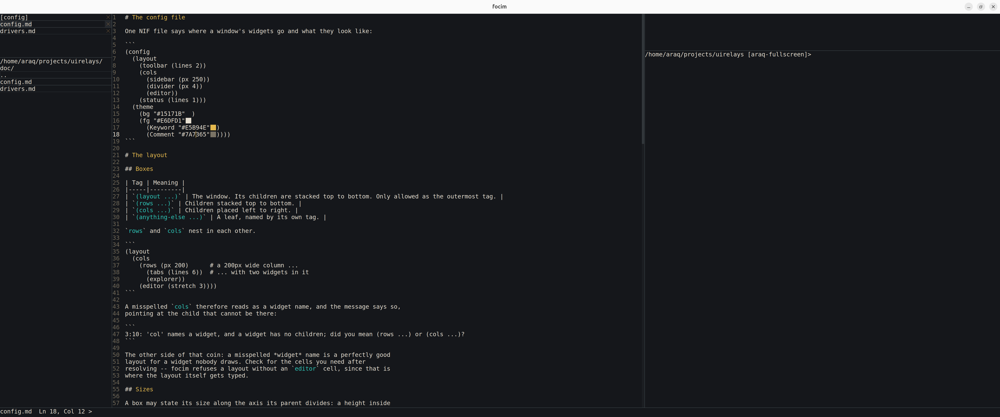

# uirelays — Native & Web UI Relays for Nim (`--mm:arc`)

Native Nim UI library based on the idea of **"relays"** — dependency injection via global callbacks. Supports **Pure Vanilla HTML5/CSS3/JS (DOM)**, **HTML5 `<canvas>` 2D**, **Windows API**, **X11**, **Cocoa**, **GTK4**, **SDL2**, **SDL3**, and **FigDraw**. Write UI applications as easily as terminal apps!

[](https://github.com/Araq/focim)

*[focim](https://github.com/Araq/focim), the Focussed Nim Editor, is written with it and runs natively in the browser on both web backends.*

---

## Документация на русском языке (UIRelays Web Backends)

В этой ветке (`uirelays-web-backends`) реализованы **два независимых веб-бекенда** для `uirelays` (`v0.11.0`), написанные **исключительно на Nim с `--mm:arc`** без внешних зависимостей и без WebAssembly:

1. **Pure Vanilla HTML5 + CSS3 + JS (DOM) Backend (`-d:html`)**:
   - **Строго без `<canvas>` и без WASM** (`0` элементов `<canvas>`, `0` вызовов `WebAssembly`).
   - Рендерит графические примитивы `uirelays` напрямую в абсолютные DOM-элементы внутри `#uir-viewport`:
     - `.uir-rect`, `.uir-point`, `.uir-line-h`, `.uir-line-v`, `.uir-svg-line` (для диагональных линий), `.uir-text` (для текста), `.uir-img-crop`, `.uir-blit-clip`, `.uir-clip` (многоугольный `clip-path`).
   - **Субпиксельная точность моноширинной сетки (`0.000px` погрешность)**:
     - В `buildFontCssStyle` используется `font-variant-ligatures:none;letter-spacing:calc(<charWidth>px - 1ch);`, а ширина символа унифицирована между обычным и жирным (`bold`) начертанием.
     - Каждый символ в `<span class="uir-text">` занимает ровно `slot.charWidth` пикселей (`8.000px` при `14px`), благодаря чему курсор стоит идеально ровно на границе символов, выделение совпадает с глифами с точностью до `0.000px`, а строки не сдвигаются при выделении текста или подсветке скобок.
2. **Separate HTML5 `<canvas>` 2D Backend (`-d:canvas`)**:
   - Отдельный бекенд на базе `<canvas id="uir-canvas">` и `CanvasRenderingContext2D` (**строго без WASM**).
   - Поддерживает полный набор примитивов `uirelays`, включая `blitRGBA`, `drawImage`, `setClipRect`, `saveState`/`restoreState` и точный шаг глифов через `ctx.letterSpacing`.

### Два режима работы веб-бекендов

- **Автономный интерактивный режим в браузере (`nim js --mm:arc -d:danger --opt:size -d:html`)**:
  - Макрос `{.uirApp.}` в `src/uirelays.nim` автоматически трансформирует классический цикл `while running: ... refresh(); sleep(16)` в асинхронный браузерный цикл (`window.__uirScheduleFrame` + мгновенный `window.__uirStepNow()` при событиях ввода и изменения размера окна).
  - Скрипт `tools/export_interactive_html.nim` собирает все 9 приложений в полностью автономные `.html` файлы (`exported_html/*.html` и единый бандл `exported_html/uirelays_all_apps.html`), которые работают прямо при открытии файла (`file://` или в изолированном `iframe` без сервера и сети), поддерживают все нажатия кнопок, ввод с клавиатуры, перетаскивание сплиттеров, анимации и **динамически меняют размер интерфейса от размера окна браузера** (`ResizeObserver`).
- **Серверный режим (`nim c --mm:arc -d:html` или `-d:canvas`)**:
  - Нативное приложение на Nim поднимает встроенный неблокирующий HTTP + SSE сервер (`0.0.0.0`, порт задается через `UIRELAYS_PORT`, по умолчанию `8080`).

### Включенные приложения и примеры (`exported_html/`)

| Приложение | Исходный код | Автономный HTML | Описание |
|---|---|---|---|
| **1. Calculator** | [`examples/calculator.nim`](examples/calculator.nim) | [`exported_html/calculator.html`](exported_html/calculator.html) | Минималистичный калькулятор с лентой вычислений, поддержкой мыши, клавиатуры и ресайза окна |
| **2. Snake** | [`examples/snake.nim`](examples/snake.nim) | [`exported_html/snake.html`](exported_html/snake.html) | Классическая «Змейка» с экранными кнопками управления (`▲`, `▼`, `◄`, `►`, `Pause`, `Restart`) и адаптивным полем |
| **3. 2048** | [`examples/twenty48.nim`](examples/twenty48.nim) | [`exported_html/twenty48.html`](exported_html/twenty48.html) | Игра 2048 с экранными кнопками (`Up`, `Down`, `Left`, `Right`, `New Game`), клавиатурой и масштабированием |
| **4. Focim IDE** | [`focim_web_port/focim_browser.nim`](focim_web_port/focim_browser.nim) | [`exported_html/focim.html`](exported_html/focim.html) | Полноценный редактор кода `Araq/focim` (`SynEdit`) с интерактивным редактированием файлов, переключением вкладок и тем (`dark`, `paper`, `amber`), живым редактированием `[config]` и `[layout]`, перетаскиванием границ панелей и точным выделением текста |
| **5. Web Showcase** | [`examples/web_showcase.nim`](examples/web_showcase.nim) | [`exported_html/web_showcase.html`](exported_html/web_showcase.html) | Демонстрация всех возможностей `uirelays`: виджеты, клиппинг, процедурный 32-bit RGBA `blitRGBA`, телеметрия событий |
| **6. Todo App** | [`examples/todo.nim`](examples/todo.nim) | [`exported_html/todo.html`](exported_html/todo.html) | Менеджер задач с полноценным перемещением курсора по тексту (`←`, `→`, `Home`, `End`, `Ctrl+←/→`), выделением текста мышью и клавиатурой (`Shift+стрелки`, `Ctrl+A/C/X/V`, двойной/тройной клик) и редактированием в середине строки |
| **7. Paint** | [`examples/paint.nim`](examples/paint.nim) | [`exported_html/paint.html`](exported_html/paint.html) | Графический редактор с палитрой цветов, размером кисти (`Brush -`, `Brush +`, `Clear`) и рисованием мышью |
| **8. Layout Demo** | [`examples/layout_demo.nim`](examples/layout_demo.nim) | [`exported_html/layout_demo.html`](exported_html/layout_demo.html) | Интерактивный редактор разметки NIF с перетаскиванием разделителей и кнопками `[+ Split Right]`, `[+ Split Down]`, `[- Remove Pane]`, `[Reset Layout]` |
| **9. Hello** | [`examples/hello.nim`](examples/hello.nim) | [`exported_html/hello.html`](exported_html/hello.html) | Анимированная сцена с переключением цветовых тем и интерактивным прицелом |
| **10. Hammerhead Reef** | [`examples/sharks.nim`](examples/sharks.nim) | [`exported_html/sharks.html`](exported_html/sharks.html) | Молотоголовые акулы на с дизерингом по матрице Байера 10 240 клеток: испечённое один раз морское дно идёт через `blitRGBA`, биолюминесценция, HUD и панель управления. Служит ещё и измерительным прибором — см. [идентичность между бекендами](#идентичность-между-операционными-системами-и-бекендами) |
| **Все 10 в одном файле** | [`tools/export_interactive_html.nim`](tools/export_interactive_html.nim) | [`exported_html/uirelays_all_apps.html`](exported_html/uirelays_all_apps.html) | Единая интерактивная галерея всех 10 приложений с мгновенным переключением вкладок |

### Тестирование и «обезьяньи тесты» (Monkey Testing)

Все тесты написаны на чистом Nim (`--mm:arc`) и запускаются через `tests/tester.nim`:
- `tests/web_html_test.nim` — **57 / 57 PASS** (проверка всех примитивов DOM-драйвера, отсутствия `<canvas>` и `WebAssembly`, UTF-8 метрик, PNG-кодировщика, событий и HTTP/SSE).
- `tests/web_canvas_test.nim` — **25 / 25 PASS** (проверка команд `<canvas>` 2D, дедупликации кадров FNV-1a, `blitRGBA`, событий и HTTP/SSE).
- `tests/web_backend_regression_test.nim` — **56 / 56 PASS** (`-d:html`), **31 / 31 PASS** (`-d:canvas`): по одной проверке на каждый исправленный дефект, чтобы он не вернулся незамеченным (пропорциональные метрики, полноэкранная заливка, политика переполнения очереди, битый JSON, клампинг ресайза, диагностика `{.uirApp.}`, инкрементальный reconcile, семантический анализ под `--os:windows`).
- `tests/server_monkey_test.nim` — **56 / 56 PASS** (обезьяньи тесты живого нативного HTTP/SSE-сервера: неизвестные пути, `405`/`204`, `/health`, битый JSON, флуд событиями, 24 SSE-клиента, чистое завершение). Браузер не нужен.
- `tests/jsdom_monkey_test.nim` — **14 / 14 PASS** (обезьяньи тесты экспортированного бандла под `node` + `jsdom`: 10 приложений, 120 случайных шагов на каждое, шторм ресайзов, контракт моста). Браузер не нужен, сеть не нужна.
- `tests/standalone_html_monkey_test.nim` — **9 / 9 APPS PASS** (запуск автономного `.html` бандла в Headless Chromium через `file://` без сети, проверка нажатий кнопок, анимаций, ввода/редактирования текста в `Focim IDE` и `Todo`, точности выравнивания глифов `8.000px` и динамического ресайза окна).
- `tests/portability_math_test.nim` — **29 / 29 PASS** на C-бэкенде и **29 / 29 PASS** на JS-бэкенде, причём вывод совпадает побайтно: 32-битное умножение, uint32-арифметика, `floor`-квантование, `sin`/`cos`/`atan2`/`sqrt`/`exp`/`ln`/`pow` против дайджестов, побайтовый PNG-кодировщик `blitRGBA` на обоих бэкендах (включая буфер со смещением 2 — это проверка ABI пары указателя на JS) и политика кэша блитов.
- `tests/monkey_browser_test.nim` — **56 / 56 PASS** (стресс-тестирование живых серверов в Headless Chromium; проверки, которым нужен браузер, корректно пропускаются, если он не установлен).
- Отчет и комментарии по работе `fossil-nim` сохранены в [`FOSSIL_NIM_COMMENTS_RU.md`](FOSSIL_NIM_COMMENTS_RU.md).
- Разбор найденных и исправленных дефектов: [`doc/WEB_BACKEND_DEFECTS.md`](doc/WEB_BACKEND_DEFECTS.md).

### Идентичность между операционными системами и бекендами

«Выглядит одинаково везде» — утверждение, которое нельзя проверить на глаз,
поэтому оно проверяется арифметикой. `examples/sharks.nim` рисует одну
детерминированную сцену (120 кадров 1024×640, движение по счётчику кадра —
никогда по часам и никогда по ГСЧ) и печатает дайджест каждого аргумента
примитива, отданного бекенду, каждого пикселя испечённого дна и каждой позиции
сустава. Эталон — [`tests/sharks_digest_golden.txt`](tests/sharks_digest_golden.txt).

```sh
# Один бекенд -> <каталог>/<backend>.digest
sh tools/sharks_run.sh native /tmp/digests 120   # X11 / Cocoa / WinAPI, что выберет система
sh tools/sharks_run.sh gtk4   /tmp/digests 120   # универсальный, Linux и macOS
sh tools/sharks_run.sh html   /tmp/digests 120   # веб-бекенд, чистый HTML/CSS
sh tools/sharks_run.sh canvas /tmp/digests 120   # веб-бекенд, <canvas> 2D
sh tools/sharks_run.sh jsdom  /tmp/digests 120   # та же страница nim js в настоящем DOM
sh tools/sharks_run.sh chrome /tmp/digests 120   # та же страница в headless Chrome/Edge

# Судья: таблица, аннотации ::error:: при расхождении, код возврата 1
nim c --mm:arc --path:src -r tools/sharks_crosscheck.nim \
  --dir=/tmp/digests --golden=tests/sharks_digest_golden.txt \
  --require=native,html,canvas,jsdom,chrome
```

```
  backend   frames rects   geom      bake      sc        txt       pos        verdict
  html      120    203621  41ecda66  60495a65  3974762f  96a23cb2  a9559246   MATCH
  canvas    120    203621  41ecda66  60495a65  3974762f  96a23cb2  a9559246   MATCH
  jsdom     120    203621  41ecda66  60495a65  3974762f  96a23cb2  a9559246   MATCH
```

Проверяются `geom` (аргументы примитивов), `bake` (все 655 360 пикселей дна),
`txt` (текст), `sc` (трансцендентные функции — `libm` против V8) и счётчики
дошедших примитивов. `pos` **сообщается, но не проверяется**: вместе с
библиотекой шрифт не поставляется, поэтому `measureText` законно даёт разные
числа на разных платформах, и гнать его в эталон значило бы сделать проверку
хрупкой, не найдя ни одного бага.

Из дайджеста `chrome` видно, как достаётся результат настоящего браузера:
хук, поставленный до скрипта приложения, поднимает строку `SHARKS_DIGEST` в
атрибут на `<html>`, а `--dump-dom` её оттуда вычитывает — консоль headless-
браузера наружу не отдаётся.

Сцена написана так, а не иначе, из-за конкретной ловушки: референсная демка,
с которой переносились акулы, считает хэш как `int32 * int32`, и на JS-бэкенде
это теряет биты выше 2^53 — `374761393 * 12345` даёт 4262848038 нативно и
2293536820 в браузере. **В браузере она рисует другой риф**, и заметить это
можно только побайтным сравнением. Переносимый примитив `mul32`, uint32 с
логическими сдвигами, квантование через `int(floor(x * SCALE))` и
`jsRound(x) = int(floor(x + 0.5))` вместо Nim-овского `round` — всё это
зафиксировано `tests/portability_math_test.nim`.

### Воспроизводимость на чистом клоне

Ни один тест не ссылается на пути вида `/home/user/...`. Всё ищется относительно
корня репозитория (`UIRELAYS_ROOT` переопределяет его). Тесты, которым нужен
браузер, пропускаются, если браузера нет, — вместо них запускайте
`server_monkey_test` и `jsdom_monkey_test`.

Требуется только Nim **2.2+** (проверено на 2.2.4) и, для `jsdom`-набора,
`node` с `npm` (зависимость ставится автоматически). Всё остальное тесты
находят сами или пропускают. Полный прогон — `nim c --mm:arc -r tests/tester.nim`;
он печатает `SKIP` для тех наборов, чей инструмент не установлен.

Если Nim в системе нет, его соберёт `tools/bootstrap_nim.sh` — из исходников с
GitHub, через штатный `csources_v2` + `koch boot` (нужны только `git` и `gcc`):

```sh
sh tools/bootstrap_nim.sh                 # соберёт в ~/.local/nim-2.2.4
export PATH="$HOME/.local/nim-2.2.4/bin:$PATH"
sh tools/bootstrap_nim.sh                 # повторно просто найдёт его и смолчит
```

Скрипт уважает `NIM=/path/to/nim` — его же читают и обёртки тестов, так что
свой компилятор можно не пересобирать. Его stdout — это ровно путь к годному
компилятору (все служебные сообщения уходят в stderr), поэтому его можно
использовать прямо в обёртке:

```sh
export PATH="$(dirname "$(sh tools/bootstrap_nim.sh)"):$PATH"
```

### Continuous Integration

[`.github/workflows/ci.yml`](.github/workflows/ci.yml) прогоняет всё это на
каждом пуше и на каждом PR, на чистом клоне, где ни Nim, ни браузер руками не
ставились:

- **`suite`** (`ubuntu-latest`) — собирает Nim 2.2.4 из исходников через
  `bootstrap_nim.sh`, ставит `jsdom` через `npm ci`, выполняет `tester.nim`
  целиком. `ubuntu-latest` поставляется с Chrome, поэтому браузерные стадии
  здесь **выполняются по-настоящему**; если они вдруг пропустятся, задача
  падает — молчаливый пропуск 18 проверок не сойдёт за зелёный билд.
- **`fuzz`** — та же обезьяна на трёх других seed'ах и по 300 шагов на
  приложение. Фикс, выживающий только на seed `20261019`, не проходит.
- **`portability`** (`macos-latest`, `windows-latest`) — нативные драйверы
  Cocoa и WinAPI, которые на Linux не компилируются вовсе, плюс все веб-тесты.
- **`sharks`** (`ubuntu-latest`, `macos-latest`, `windows-latest`) — одна и та
  же сцена через каждый бекенд, который на этой системе вообще есть: нативный
  (X11 / Cocoa / WinAPI), GTK 4 (Linux и macOS; для MSVC/mingw на Windows
  пакета разработки GTK 4 нет), оба веб-бекенда в серверном режиме, сборка
  `nim js` в настоящем DOM и та же сборка в headless-браузере системы. Каждый
  бекенд — отдельный шаг с отдельной аннотацией, и падение одного не
  останавливает остальные: один прогон CI сообщает все сломанные бекенды, а не
  только первый. В конце `tools/sharks_crosscheck.nim` сравнивает все
  полученные дайджесты с эталоном и падает в том числе если обязательный
  бекенд не дал дайджеста вовсе. Здесь же на каждой системе прогоняется
  `tests/portability_math_test.nim` на обоих бэкендах — против `libm` именно
  этой операционной системы. На ubuntu и macOS Nim собирается из исходников
  тем же `bootstrap_nim.sh`, то есть «скомпилируется само на той системе, на
  которой работает» — не предположение, а шаг пайплайна.

Отдельный гейт следит, чтобы `exported_html/` не отставал от примеров: бандл
перегенерируется и сравнивается с HEAD. Экспорт детерминирован, поэтому любое
расхождение означает, что пример или экспортер изменили, а бандл забыли
пересобрать.

```sh
# Браузер не нужен, сеть не нужна:
nim c --mm:arc --outdir:/tmp/uirelays_bins -r tests/server_monkey_test.nim
nim c --mm:arc --outdir:/tmp/uirelays_bins -r tests/jsdom_monkey_test.nim   # нужен node + npm
nim c --mm:arc -d:html   --outdir:/tmp/uirelays_bins -r tests/web_html_test.nim
nim c --mm:arc -d:canvas --outdir:/tmp/uirelays_bins -r tests/web_canvas_test.nim

# Нужен headless-браузер (или UIRELAYS_BROWSER=/path/to/browser):
UIRELAYS_BROWSER=$(command -v chromium) nim c --mm:arc --outdir:/tmp/uirelays_bins -r tests/monkey_browser_test.nim
```

---

## Getting Started (English)

`import uirelays` is all you need — it re-exports everything and automatically initializes the backend:
- Native desktop default: WinAPI on Windows, Cocoa on macOS, X11 on Linux/BSD (or override with `-d:sdl3`, `-d:sdl2`, `-d:gtk4`, `-d:figDrawWindy`, `-d:figDrawSiwin`).
- Web backends (`--mm:arc`, zero external dependencies, zero WASM):
  - `-d:html` (`-d:uirelaysHtml` / `--define:"features.uirelays.html"`): **Pure Vanilla HTML5 + CSS3 + JS (DOM) Backend** — strictly **no `<canvas>`** and **no WASM**.
  - `-d:canvas` (`-d:uirelaysCanvas` / `--define:"features.uirelays.canvas"`): **Separate HTML5 `<canvas>` 2D Backend** — strictly **no WASM**.

### Quick Build & Run Commands

```sh
# 1. Build all standalone interactive offline HTML files (nim js --mm:arc -d:html)
nim c --mm:arc -r tools/export_interactive_html.nim

# 2. Run the full test suite (unit + HTTP integration + Headless Chromium monkey tests)
nim c --mm:arc -r tests/tester.nim

# 3. Compile any app as a live HTTP/SSE server on Pure HTML/CSS DOM (-d:html)
nim c --mm:arc -d:html examples/calculator.nim
nim c --mm:arc -d:html examples/snake.nim
nim c --mm:arc -d:html examples/twenty48.nim
nim c --mm:arc -d:html examples/todo.nim
nim c --mm:arc -d:html --path:src --path:focim_web_port focim_web_port/focim_browser.nim

# 4. Compile any app on the separate HTML5 <canvas> 2D backend (-d:canvas)
nim c --mm:arc -d:canvas examples/web_showcase.nim
nim c --mm:arc -d:canvas examples/paint.nim
```

### JavaScript target notes

- `int64` on the JS target is emulated with `BigInt` unless you pass
  `--jsbigint64:off`. **Both work**, but the switch is not free:
  `--jsbigint64:off` additionally requires `-d:nimStringHash2`, otherwise the
  build fails inside the standard library:

  ```sh
  # default: int64 -> BigInt, no extra flags
  nim js --mm:arc -d:html --path:src examples/calculator.nim

  # smaller and faster on 32-bit-safe code, but needs the hash define too
  nim js --mm:arc -d:html --jsbigint64:off -d:nimStringHash2 --path:src examples/calculator.nim
  ```

  Mixing the two is the usual trap: `--jsbigint64:off` without
  `-d:nimStringHash2` fails with
  `Error: Must use \`-d:nimStringHash2\` when using \`--jsbigint64:off\``.
  Pick one pair and use it consistently for every JS artifact you link
  together.

### Declaring your minimum window size

A web app should tell the backend the smallest window it can be laid out in:

```nim
let win = createWindow(680, 520)
setMinViewport(680, 520)     # the layout below is drawn for this size
```

Without it the only lever an app has is clamping its own layout variable
(`width = max(680, ev.x)`), which makes the drawing *wider than the window*
instead of making the window big enough. `overflow:hidden` then does not make
the overflow reachable — it hides it, and with it every button that happened to
be on the far side.

`setMinViewport` is an optional relay: the web backends enforce it, backends
that have no say in how small their window may get ignore it, so an app should
still clamp its own layout for portability. Where an embedder also declares a
floor (`window.__uirMinViewport`), the two combine component-wise by maximum —
an embedder can give an app more room, never less than it asked for.

Every example under `examples/` declares its own design size this way.

---

## Architecture

The library is split into five relay groups:

| Module | Relays | Purpose |
|--------|--------|---------|
| `screen` | `windowRelays` | Window lifecycle, cursor, clip rect, save/restore state |
| `screen` | `fontRelays` | Font loading, deterministic text measurement and rendering |
| `screen` | `drawRelays` | Rectangles, lines, points, images, 32-bit RGBA blitting |
| `input` | `inputRelays` | Mouse, keyboard, text input, window resize events, timing |
| `input` | `clipboardRelays` | Copy/paste synchronization |

Drivers populate these relay objects at init time. Application code calls convenience wrappers (`fillRect`, `drawText`, `pollEvent`, `waitEvent`, ...) that dispatch through the relays.

## Drivers

| Driver | Platform | System API / External Dependencies |
|--------|----------|-------------|
| `html_driver` (`-d:html`) | Web Browser (Pure DOM, Server or Standalone JS) | Pure HTML5/CSS3/JS DOM (`--mm:arc`, **no `<canvas>`, no WASM**, zero external deps) |
| `canvas_driver` (`-d:canvas`) | Web Browser (Canvas 2D) | HTML5 `<canvas>` 2D (`--mm:arc`, **no WASM**, zero external deps) |
| `winapi_driver` (default on Windows) | Windows | Native Win32 API / GDI (built into Windows, no external dependencies needed) |
| `cocoa_driver` (default on macOS) | macOS | Native Cocoa / AppKit (built into macOS, no external dependencies needed) |
| `x11_driver` (default on Linux/BSD) | Linux/BSD | libX11, libXft |
| `gtk4_driver` (`-d:gtk4`) | Linux/BSD | GTK4, Cairo, Pango |
| `sdl3_driver` (`-d:sdl3`) | Cross-platform | SDL3, SDL3_ttf |
| `sdl2_driver` (`-d:sdl2`) | Cross-platform | SDL2, SDL2_ttf |
| `figdraw_windy_driver` (`-d:figDrawWindy`) | Cross-platform | FigDraw, Windy |
| `figdraw_siwin_driver` (`-d:figDrawSiwin`) | Cross-platform | FigDraw, siwin |

See:
- [Web Backends Architecture & Guide](doc/web_backends.md)
- [Writing a Custom Driver](doc/drivers.md)
- [Wiki Pages](wiki/Home.md) (`HtmlDomBackend.md`, `Canvas2DBackend.md`, `MonkeyTesting.md`)
- [Отчет и комментарии по `fossil-nim` (`FOSSIL_NIM_COMMENTS_RU.md`)](FOSSIL_NIM_COMMENTS_RU.md)

## License

MIT
