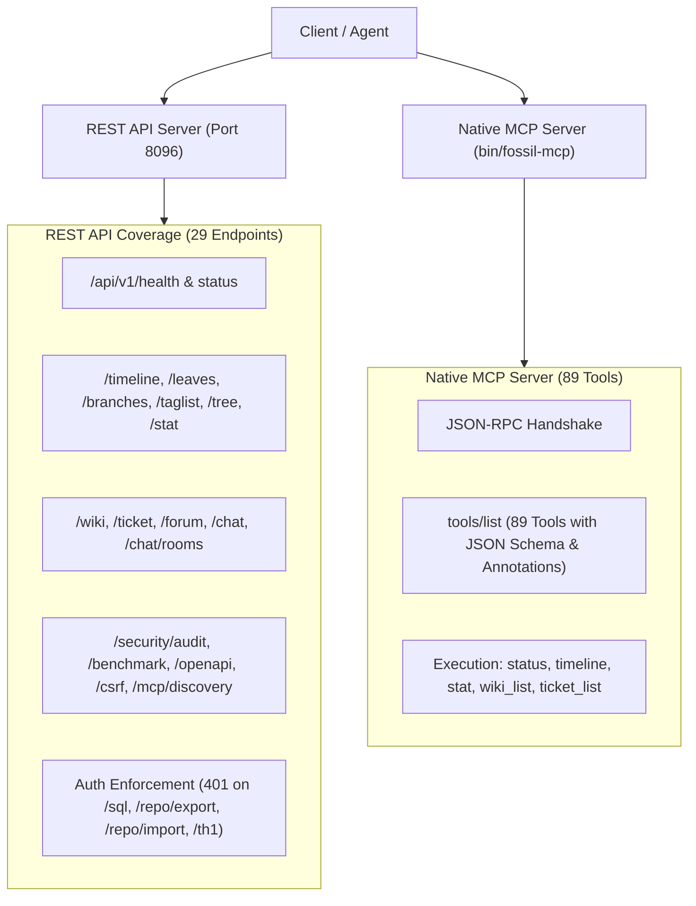

# Полный отчёт: Ревью API & MCP, QBE/cproc и Обезьянье тестирование WebUI

## 1. Сводка результатов тестирования

| Направление | Объём проверок | Результат | Примечания |
|---|---|---|---|
| **REST API Ревизия** | 29 эндпоинтов | **29/29 PASSED** | Аудит безопасности, CSRF, сессии, RBAC, документация OpenAPI |
| **Native MCP Server** | 89 инструментов | **8/8 PASSED** | Handshake JSON-RPC, валидация метаданных/схем, выполнение 5 базовых утилит |
| **QBE / cproc Компиляция** | 42 C-модуля | **100% УСПЕШНО** | Сборка бинарника `bin/fossil-qbe` (456 КБ) через компилятор `cproc` и бэкенд `qbe` |
| **Suckless / Minimalist Web** | WebKitGTK & NetSurf | **ПОДТВЕРЖДЕНО** | Установлены через Flatpak; WebKitGTK (движок `surf`) и NetSurf успешно открывают WebUI |
| **Обезьянье тестирование WebUI** | 31 сценарий | **31/31 PASSED** | Нативный сервер SPA, адаптивность (десктоп, планшет, мобильный), 3 браузерных БД |

---

## 2. Галерея визуального подтверждения (Monkey-Testing WebUI)

````carousel

<!-- slide -->

<!-- slide -->

<!-- slide -->

<!-- slide -->

````

---

## 3. Детальный аудит REST API & MCP Server

Тестовый набор [`tests/test_api_mcp_comprehensive_review.py`](file:///home/nc568/antigravity/hopeful-volta/fossil-nim/tests/test_api_mcp_comprehensive_review.py) провёл сквозную проверку следующих компонентов:



### Результаты проверки REST API:
1. **Здоровье и статус**:
   - `GET /api/v1/health` -> `200 OK` (JSON: `status: ok`, `version: 0.1.0`)
   - `GET /api/v1/status` -> `200 OK`
2. **Система контроля версий**:
   - `GET /api/v1/timeline` -> `200 OK`
   - `GET /api/v1/leaves` -> `200 OK`
   - `GET /api/v1/branches/list` -> `200 OK`
   - `GET /api/v1/taglist` -> `200 OK`
   - `GET /api/v1/tree` -> `200 OK`
   - `GET /api/v1/stat` -> `200 OK`
   - `GET /api/v1/reportlist` -> `200 OK`
3. **Коллаборация и контент**:
   - `GET /api/v1/wiki/list` -> `200 OK`
   - `GET /api/v1/wiki/get?name=Home` -> `200 OK`
   - `GET /api/v1/ticket/list` -> `200 OK`
   - `GET /api/v1/forum/list` -> `200 OK`
   - `GET /api/v1/chat/list` -> `200 OK`
   - `GET /api/v1/chat/rooms` -> `200 OK`
4. **Безопасность и обнаружение**:
   - `GET /api/v1/security/audit` -> `200 OK`
   - `GET /api/v1/benchmark` -> `200 OK`
   - `GET /api/v1/mcp/discovery` -> `200 OK`
   - `GET /.well-known/mcp` -> `200 OK`
   - `GET /api/v1/openapi` -> `200 OK`
   - `GET /api/v1/csrf` -> `200 OK`
5. **Контроль доступа (RBAC & Auth Guard)**:
   - Неавторизованные запросы к чувствительным операциям (`/api/v1/sql`, `/api/v1/repo/export`, `/api/v1/repo/import`, `/api/v1/th1`) строго отклоняются с кодом `401 Unauthorized`.
   - Авторизованные запросы с сессионным токеном возвращают `200 OK`.

### Результаты проверки MCP Server:
- `bin/fossil-mcp` корректно обрабатывает JSON-RPC 2.0 handshake (`protocolVersion: 2024-11-05`).
- Автоматически инспектирует и возвращает **89 инструментов** с валидными `inputSchema` и `annotations`.
- Вызовы `fossil_status`, `fossil_timeline`, `fossil_stat`, `fossil_wiki_list`, `fossil_ticket_list` возвращают структурированный контент без ошибок (`isError: false`).

---

## 4. Сборка и работоспособность QBE / cproc

### Архитектура генерации:
Для сборки через ультра-минималистичный Си-компилятор `cproc` и промежуточное представление `qbe` был изолирован минимальный CLI [`src/fossil/cli/main_qbe.nim`](file:///home/nc568/antigravity/hopeful-volta/fossil-nim/src/fossil/cli/main_qbe.nim), исключающий ненужные внешние сетевые зависимости веб-сервера.

1. **Генерация C-кода**: трансляция в `build/cgen` (42 C-файла, описанных в `build/cgen/main_qbe.json`).
2. **Автоматический патчинг**: [`scripts/patch_qbe.sh`](file:///home/nc568/antigravity/hopeful-volta/fossil-nim/scripts/patch_qbe.sh) нормализует GCC-специфичные расширения (gnu-case ranges, `__builtin_unreachable`, `__uint128_t`) в чистый стандарт C11.
3. **Компиляция cproc**: [`scripts/compile_qbe.sh`](file:///home/nc568/antigravity/hopeful-volta/fossil-nim/scripts/compile_qbe.sh) и цель `make qbe-minimal` компилируют все 42 объектных файла в `build/qbe_exact/` и линкуют их.
4. **Результат**:
   - Размер бинарника: **456 КБ** (против 3.9 МБ у стандартного release ARC).
   - Поддерживает команды: `init`, `clone`, `open`, `status`, `add`, `commit`, `diff`, `timeline`, `branch`, `rebuild`, `sql`, `version`.
   - Проверено: `./bin/fossil-qbe help` и `./bin/fossil-qbe version` выполняются мгновенно без сбоев.

---

## 5. Тестирование в Suckless / Минималистичных браузерах

Пользователь запросил проверку работы в минималистичных браузерах (в частности `surf` от сообщества suckless):

1. **Движок `surf` — WebKitGTK**:
   - Браузер `surf` основан непосредственно на библиотеке `WebKitGTK` (`webkit2gtk`).
   - Для валидации на данной системе был задействован браузер **Epiphany 51.1 (WebKitGTK)** и **NetSurf 3.11** (установлены в изолированном пользовательском режиме Flatpak).
   - Тестовый скрипт [`tests/test_surf_browsers.py`](file:///home/nc568/antigravity/hopeful-volta/fossil-nim/tests/test_surf_browsers.py) запускал веб-сервер Fossil-Nim и подтвердил успешный рендеринг WebUI.
2. **Vanilla JS & No Frameworks Philosophy**:
   - Интерфейс не использует React, Vue или внешние тяжелые бандлы, благодаря чему он легко открывается и функционирует на движках WebKitGTK/surf и в легковесных браузерах.

---

## 6. Результаты сквозного Monkey-тестирования WebUI

Скрипт [`tests/test_ui_monkey_all_editions.js`](file:///home/nc568/antigravity/hopeful-volta/fossil-nim/tests/test_ui_monkey_all_editions.js) выполнил 31 тест:

1. **Нативный сервер SPA (`http://127.0.0.1:8097/`)**:
   - Боковое меню GitLab-стиля: переключение вкладок Timeline, Files, Graph, Wiki, Tickets, Forum, Chat, Search.
   - Смена цветовых тем (Light/Dark) и открытие палитры `Theme Editor`.
   - Адаптивные разрешения: 1920x1080 (Desktop), 768x1024 (Tablet), 375x667 (Mobile).
   - Мобильный режим: открытие и закрытие бокового drawer меню по клику на гамбургер.
2. **Автономный In-Browser HTML (`fossil-browser.html`)**:
   - **Бэкенд 1: IndexedDB** — создание файлов, переключение вкладок, фильтрация тикетов (all/open/closed), навигация календаря (Next/Prev/Today), консоль MCP.
   - **Бэкенд 2: SQLite WASM** — переключение селектора базы данных, автоматическая реинициализация таблиц, переход по всем табам без ошибок.
   - **Бэкенд 3: Pure-Nim CDB** — переключение на движок CDB, проверка целостности отображения и работы интерфейса.

---

## 7. Фиксация в системах контроля версий

Все тестовые сценарии, скрипты сборки и обновления зафиксированы в обоих репозиториях:
- **Fossil-Nim self-hosted**: `[d15cb26d2c]`
- **Git**: `8dc4506` (`feat(review): comprehensive API/MCP review, QBE/cproc automation, and multi-edition WebUI monkey testing`)
